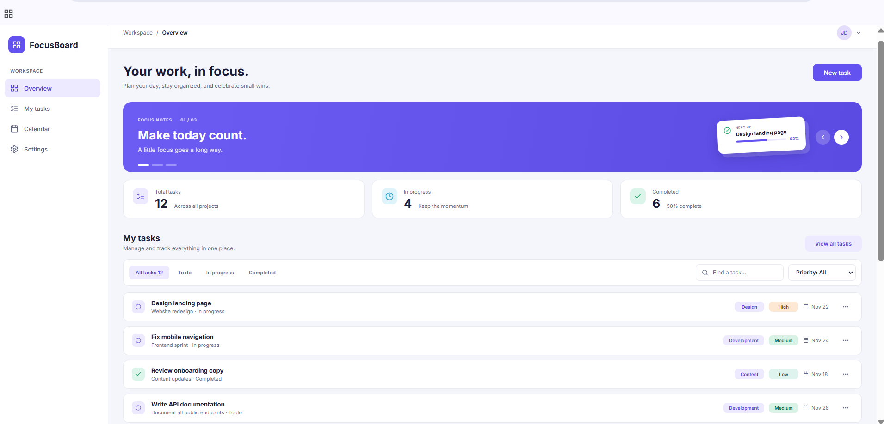
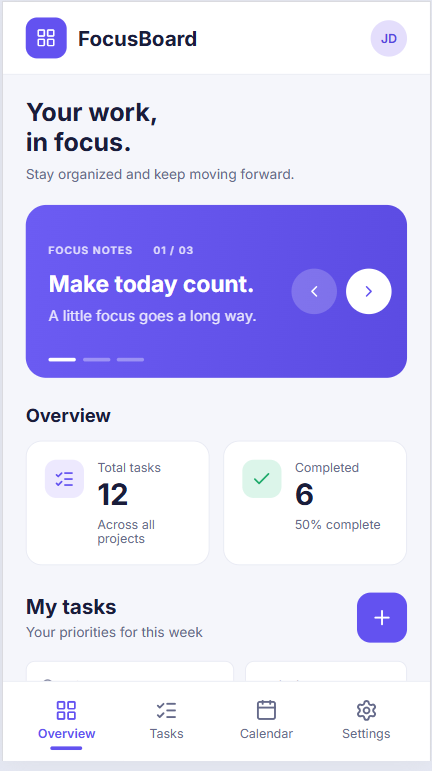

# FocusBoard

A responsive, single-user task dashboard built with React and Vite. Users can create, edit, delete and filter tasks, track progress through live statistics, and browse a three-slide Focus Notes carousel. All data is saved in the browser with localStorage.

- **Live app:** https://focusboard-khaki.vercel.app/
- **GitHub repository:** https://github.com/Balabhasakar/focusboard

## Screenshots

| Desktop (1440 px) | Mobile (390 px) |
| --- | --- |
|  |  |

## Tech stack

- React 19 with Hooks (`useState`, `useEffect`, `useRef`)
- Vite
- JavaScript (ES6+)
- Plain CSS with CSS variables (one stylesheet per component group)
- Lucide React for icons
- localStorage for persistence
- ESLint for code quality

## Features

- **Create, edit and delete tasks.** One form component handles both create and edit. Deleting asks for confirmation first.
- **Status updates.** Each task can be moved between To do, In progress and Completed from its "..." menu.
- **Search and filters.** Case-insensitive title search, status tabs (All, To do, In progress, Completed) and a priority filter all work together. A Reset button clears them.
- **Calculated statistics.** Total, In progress and Completed counts and the completion percentage are derived from the task data. Nothing is hardcoded.
- **Focus Notes carousel.** Three slides with previous/next buttons, clickable indicators and wrap-around navigation.
- **Persistence.** Tasks survive a refresh. The sample data loads only when nothing valid is saved.
- **Responsive.** Tested at 390 px, 768 px and 1440 px. The sidebar becomes a bottom navigation bar on smaller screens.
- **Accessibility.** Semantic HTML, labelled form fields, visible focus outlines, keyboard-operable dialogs with focus trapping, a skip link, status text that does not rely on colour, and screen-reader announcements for filter results.

## Getting started

Requires Node.js 18 or newer.

```bash
git clone <<< repository URL >>>
cd focusboard
npm install
npm run dev
```

Then open http://localhost:5173.

Other scripts:

```bash
npm run build     # production build in dist/
npm run preview   # serve the production build locally
npm run lint      # run ESLint
```

## Project structure

```
focusboard/
├── index.html
├── src/
│   ├── components/
│   │   ├── Sidebar.jsx          # desktop sidebar + mobile bottom nav
│   │   ├── Header.jsx
│   │   ├── Logo.jsx
│   │   ├── FocusNotes.jsx       # three-slide carousel
│   │   ├── StatCard.jsx
│   │   ├── SearchBar.jsx
│   │   ├── FilterTabs.jsx
│   │   ├── TaskList.jsx
│   │   ├── TaskCard.jsx         # row + actions menu
│   │   ├── TaskForm.jsx         # create and edit form (modal)
│   │   └── ConfirmDialog.jsx    # delete confirmation
│   ├── data/
│   │   ├── sampleTasks.js       # 12 sample tasks
│   │   └── taskValidation.js    # checks saved data is valid
│   ├── hooks/
│   │   └── useLocalStorage.js
│   ├── App.jsx
│   ├── main.jsx
│   ├── index.css
│   └── accessibility.css
├── screenshots/
├── README.md
└── AI_USAGE.md
```

## State management

I used **React hooks only** (`useState` and `useEffect`, plus a custom `useLocalStorage` hook), with state kept in `App.jsx`. The app is small and has a single screen, so a state library such as Redux or Zustand, or Context, would add complexity without a benefit.

- **Single source of truth.** The full task array lives in one place, `App.jsx`. Cards, list rows, statistics, filters and the form all read from it and receive data and callbacks as props.
- **Predictable updates.** Add, edit, status change and delete each build a new array (`[newTask, ...prev]`, `map`, `filter`) and never mutate the existing state.
- **Derived values.** Statistics and the visible task list are calculated during render from the full task array plus the search text, status tab and priority filter. They are never stored, so they can't go out of sync. Filtering only changes what is shown, never the saved data. Completion percentage is guarded against dividing by zero.
- **Form state.** The form keeps its own field values locally. `App.jsx` only knows which task is being edited (or `null` when creating). Submitting calls one `handleSave` function that decides between add and update.
- **Carousel state.** `FocusNotes` holds the active slide index. The slide, the "01 / 03" counter and the indicators all come from that one index, so they stay in sync. Previous and next use modulo arithmetic to wrap around.

## localStorage

- Tasks are stored as JSON under the key `focusboard_tasks`.
- `useLocalStorage` reads the saved value once, when the app first loads. If nothing is saved, the JSON is broken or the data fails validation (`isValidTaskList`), it falls back to the sample tasks. An empty array is valid, so deleting every task stays deleted.
- A `useEffect` writes the full task list after every change.
- Reads and writes are wrapped in `try/catch`, so blocked or full storage never crashes the app.
- Search text and filters are intentionally not saved.

## Design decisions and differences from the Figma

- **To do tab.** The Figma shows only All, In progress and Completed tabs. I added a To do tab because the requirements list To do as a status filter.
- **Statistics are calculated.** With the sample data the cards show 12 / 4 / 6 instead of the Figma's 12 / 5 / 7, and the Completed card shows the calculated completion percentage as its note.
- **Mobile carousel.** On phones I kept the working carousel instead of the static "Good afternoon" banner in the mobile frame, because the carousel must be responsive and usable.
- **Task actions.** Edit, status change and delete live in each task's "..." menu. The status is also written in the row's subtitle, so it is not shown by colour alone.
- **Category.** The Figma form has no category field, so new tasks get the category "General". Edited tasks keep their category.

## Known limitations

- **Calendar and Settings** (and the sidebar and bottom-nav items other than Overview) are visual placeholders and do not open new pages.
- The "..." menu supports Tab and Enter but not arrow-key navigation.
- The date picker is the browser's native one, so its display format follows the browser's language.
- Data is stored per browser and is not synced across devices.
- Task IDs are created with `Date.now()`, which is fine for a single user.
- There are no automated tests. Testing was done manually at 390, 768 and 1440 px.